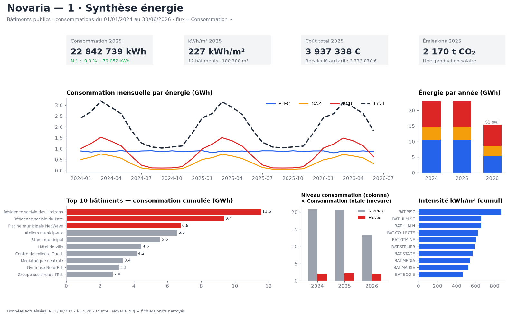

# Novaria — ETL et aide à la décision énergétique

Projet data de bout en bout : quatre sources hétérogènes (SQL Server, Excel, CSV, JSON) sont
contrôlées, nettoyées, combinées puis modélisées en étoile pour orienter une décision de
rénovation des bâtiments publics de la ville fictive de Novaria.

Le projet suit le fil rouge du cours « ETL et aide à la décision » (Power BI, TP 1 à 8). Il est
livré sous deux formes :

| Livrable | Contenu |
|---|---|
| [`src/`](src) | Pipeline **Python / pandas**, exécutable, qui produit tous les résultats |
| [`powerbi/powerquery/`](powerbi/powerquery) | Les mêmes requêtes en **Power Query M** (Staging → Contrôles → Intermédiaires → Modèle) |
| [`powerbi/dax/mesures.dax`](powerbi/dax/mesures.dax) | Colonne calculée et **mesures DAX** (N-1, kWh/m², Top 10, qualité) |
| [`output/`](output) | Résultats : rejets tracés, tables intermédiaires, modèle en étoile, KPI, décision |
| [`docs/COMPTE_RENDU.md`](docs/COMPTE_RENDU.md) | Compte rendu TP par TP : démarche, règles, chiffres, justifications |



## Résultat clé

> **Avec la consommation seule, Novaria traiterait d'abord la Résidence sociale des Horizons,
> la Résidence sociale du Parc et la Piscine municipale NeoWave** : 45 % de la consommation du parc.
> Décision provisoire : rapportée à la surface, la piscine est de loin la plus intensive
> (870 kWh/m²), et le climat, les tarifs et les audits ne sont pas encore pris en compte.

Détail : [`output/07_rapport/decision_provisoire.md`](output/07_rapport/decision_provisoire.md)

## Architecture

```
 SQL Server (vue)   Excel météo   CSV tarifs   JSON audits
        │               │             │             │
        ▼               ▼             ▼             ▼
   01_Staging  ── lecture brute, aucune correction ──────────────
        │
   02_Controles ── profil, doublons sur clé métier, RaisonRejet ──► Rejets_*
        │
   03_Intermediaires ── Int_Consommations · Int_Meteo · Int_Tarifs · Int_Audits
        │
   FactEnergie_Preparee ── + météo (quartier × mois) + tarif applicable (date d'effet)
        │
   Modèle en étoile ── FactEnergie · FactAudit · DimBatiment · DimQuartier · DimEnergie · DimDate
        │
   Rapport « Synthèse énergie » ── KPI, N-1, tendance, Top 10, décision provisoire
```

## Qualité des données en chiffres

| Source | Lignes brutes | Valides | Rejetées | Principales anomalies |
|---|---:|---:|---:|---|
| Consommations (SQL) | 26 448 | 26 448 | 0 | aucune : FK, NOT NULL, CHECK et UNIQUE protègent la source |
| Météo (Excel) | 246 | 225 | 21 | 29 formats de date, unités dans les nombres, codes quartier sales, valeurs impossibles, 11 doublons |
| Tarifs (CSV) | 19 | 17 | 2 | prix négatif, doublon, « juillet 2025 », décimales mixtes `,`/`.`, « 19,10 € » |
| Audits (JSON) | 13 | 12 | 1 | bâtiment inconnu, date `15/05/2024`, « 134 kWh/m² », espace dans un code, coût absent |

Chaque source vérifie `initial = valides + rejets`, et chaque rejet garde sa raison.

## Points techniques notables

- **Aucune suppression silencieuse** : chaque ligne écartée part dans `Rejets_*` avec une `RaisonRejet`.
- **Dédoublonnage déterministe** : on garde le chargement le plus récent (`Table.Buffer` avant `Table.Distinct` en M).
- **Null ≠ zéro** : un coût d'audit absent devient `StatutChiffrage = "À chiffrer"`, jamais 0.
- **Jointure « as-of » des tarifs** : chaque mois prend le dernier tarif dont la date d'effet est antérieure ou égale (`merge_asof` / `Table.Max`).
- **Fusion sans explosion** : le grain quartier-mois de la météo est vérifié avant la jointure. Le nombre de faits et le total de kWh sont identiques avant et après la fusion.
- **Production ≠ consommation** : la mesure DAX filtre `TypeFlux`. Sans ce filtre, `SUM(QuantiteKWh)` additionnerait les 1,45 GWh produits par le solaire aux kWh consommés.
- **N-1 sur une période comparable** : 2026 ne couvre que le premier semestre. La mesure borne donc N-1 à la même période. Sans cela, l'évolution affichée serait d'environ −32 %, un chiffre artificiel.
- **Écart de coût révélé** : le coût SQL applique le tarif de janvier 2024 à toute la période. Recalculé avec les tarifs en vigueur, le coût 2025 baisse de 164 k€ (−4,2 %).

## Exécuter

```bash
pip install -r requirements.txt
python src/run_all.py
```

Les données SQL sont lues depuis `data/sql_export/`, un export de la vue `VW_ConsommationsEnergetiques`
généré par [`data/raw/Novaria_NRJ.sql`](data/raw/Novaria_NRJ.sql) sur SQL Server Express. Le script
utilise `NEWID()` : une nouvelle exécution donne des valeurs légèrement différentes.

## Reproduire dans Power BI Desktop

1. Exécuter `data/raw/Novaria_NRJ.sql` sur SQL Server (Express suffit).
2. Créer deux paramètres : `Serveur` (ex. `.\SQLEXPRESS`) et `Dossier` (chemin de `data/raw/`).
3. Créer les requêtes de `powerbi/powerquery/` dans l'ordre 01 → 04, chacune dans son groupe.
   Désactiver le chargement de tout sauf `04_Modele`.
4. Créer les relations listées en fin de `04_Modele.pq` et marquer `DimDate` comme table de dates.
5. Coller les mesures de `powerbi/dax/mesures.dax`.

## Stack

Python 3.13 · pandas · matplotlib · SQL Server Express · Power Query M · DAX
